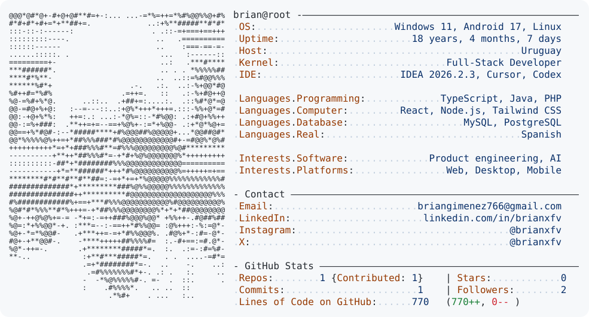

<a href="https://github.com/brianxfv">
  <picture>
    <source media="(prefers-color-scheme: dark)" srcset="https://raw.githubusercontent.com/brianxfv/brianxfv/main/assets/profile/dark_mode-f59b22f2dea7.svg">
    
  </picture>
</a>
